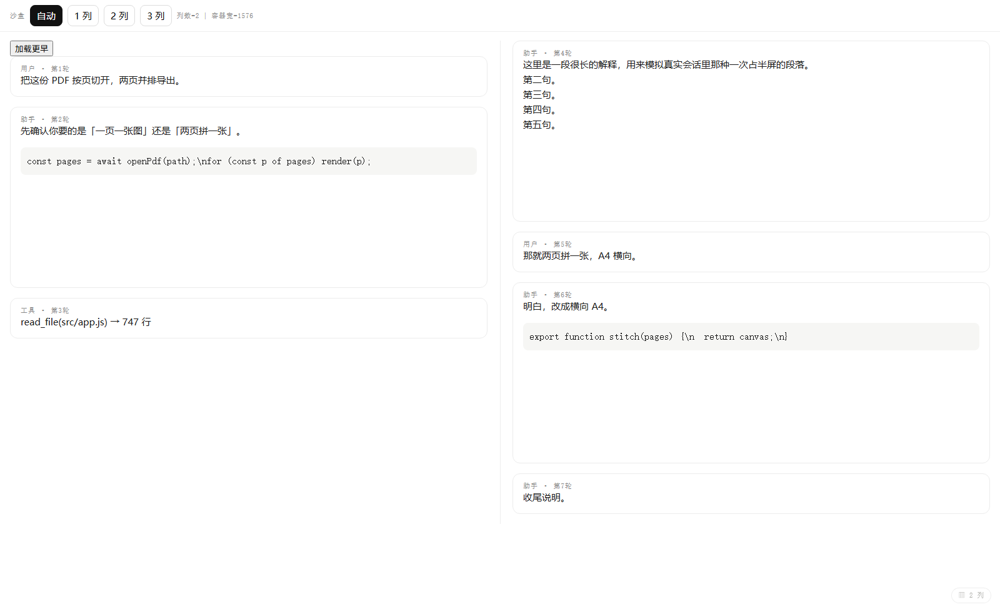

# dsh-chat-columns

> Newspaper-style multi-column layout for [DeepSeek Harness](https://github.com/deepseek-ai/deepseek-harness) (DSH) web sessions.
> All columns share the host's single scroll container — scrolling, anchors and "load earlier" keep working untouched.
> One plugin, no build step, no changes to the app shell.



把 DSH Web 的会话正文排成**报纸式多列**——所有列共用宿主唯一那个滚动容器，
滚动、锚点、「加载更早」都还是宿主原来的那套，插件只负责列宽和分栏。

> 状态：**P0 已完成**（自动分列 + 列数可切 + 热更生效）。
> P1「传送门」、P2「滚到顶自动加载」还没做，见文末路线图。

## 装

```bash
git clone https://github.com/WuZiyi521/dsh-chat-columns.git
dsh plugin --profile web add "$PWD/dsh-chat-columns"
```

装完会自动进 `~/.dsh/profiles/web/package.json` 的 `dsh.profile.bundles`，
`dsh-hmr` 在线时**几秒内自己生效**，不用重启 `dsh-web`。
没生效就重启一次 web（注意：`dsh-web` 就是这个会话本身，会让当前对话断一下）。

## 关 / 换列数

浏览器控制台：

```js
__dshChatColumns.set(1)      // 关掉（恢复单列）
__dshChatColumns.set(2)      // 固定两列
__dshChatColumns.set(3)      // 固定三列
__dshChatColumns.set("auto") // 按窗口宽度自动（默认）
__dshChatColumns.get()       // 看当前状态
```

选择记在 `localStorage["dsh-chat-columns:cols"]`，刷新后保持。

彻底卸载：

```bash
dsh plugin --profile web remove dsh-chat-columns
```

## 怎么算列数（写死，不做缩放适配）

```
cols = clamp(floor(容器宽度 / 420), 1, 3)
```

- 浏览器缩放、系统 DPI、分辨率都已经折算进 `clientWidth`（CSS px），不用管；
- 窗口/侧栏变化由 `ResizeObserver` 监听；
- 双指缩放只在移动端影响布局，桌面端忽略。

## 最关键的一处：flow 是 flex 容器

宿主的 `[data-chat-flow]` 同时带 `.column` 类，而那个类是 **`display:flex`**。
**CSS 多列对 flex 容器完全无效**——`column-count:3` 设上去毫无反应，
表现就是"插件在跑、徽标显示 3 列、但页面还是一列"。

插件因此必须把它改回 `display:block`（间距是靠行自身的 `margin-top` 给的，
block 下照样生效），沙盒里也补了这条真实条件，否则测不出来。

## 为什么要改 `--dsh-chat-content-width`

宿主给正文列写死了 `max-width: var(--dsh-chat-content-width)`（默认
`min(100% - 32px, 920px)`）。920px 摊成 3 列每列只剩约 280px，没法读。
所以多列时插件把这个变量放到 `calc(100% - 32px)`，恢复单列时**原样还回去**。

## 已知限制

1. **不是"一屏一页"的传送门**。现在用的是 CSS `column-count`，列高由浏览器均衡，
   滚动仍然是宿主的垂直滚动。P1 要想清楚怎么做再动。
2. **代码块/表格只保证不撑破列宽**（`max-width:100%` + 横向滚动），
   特别宽的内容在窄列里仍会挤。
3. **不支持把某一轮钉在列首**（`keepwithnext` 那种语义没做）。
4. 右侧 TurnNavigator 轨道不受影响，仍是它自己的虚拟列表。
5. 移动端没适配（任务书里也列了非目标）。

## 两种模式（2026-11-09 定的）

同一份内容、同一套滚动容器，两种读法互斥，**各自是独立模式**，不是谁替代谁：

| 模式 | 行为 | 适合 |
|---|---|---|
| **A · 报纸**（现在这版） | CSS 均衡分栏：总高 ÷ 列数 = 列高，内容左→右流，各列同步滚动 | 内容不长、想一眼看全貌；对比同一轮里的多段 |
| **B · 传送门**（未做） | 一屏一列：列高 = 视口高，接缝固定在底部，滚动时边界连续上移 | 长对话顺序阅读 |
| **C · 分屏**（未做） | 每栏各自独立滚动，互不影响 | 同时对照好几段，各看各的 |

模式 A 的价值独立存在：它就是"把屏幕横向用满"，不需要接管滚动，风险最低。
模式 B 才是真正的"连续阅读"，但要重映射宿主的 `scrollTop`。见下节。

### 模式 C 的硬约束（别踩坑）

"每栏独立滚动"听起来最简单（多容器 + `overflow`），但它要求**内容真的被切成 N 份**。
现在整段内容只有**一个** React 管理的节点树：

- **搬**节点进各列 → 破坏 React 的 keyed seat，下次渲染就重复/错乱；
- **克隆**节点进各列 → 按钮、审批、复制代码这些交互全失效（克隆的是死 DOM）；
- CSS 多列里的"列"不是盒子，没法给每列单独 `overflow`。

所以 C 只能是**只读分屏阅读器**：插件自己渲染一份纯文本/静态副本，
按栏切开、各自滚动。能读、能对照，但**不能在里面点按钮**。
要保留交互，就只能等宿主开一个"分栏"扩展点——目前没有。

## 路线图

| 阶段 | 内容 | 状态 |
|---|---|---|
| P0 | 自动分列、同滚动容器、窗口变窄自动回落一列 | ✅ |
| P1 | 跨列连续滚动（传送门） | ⬜ 难点：宿主只有一个 `scrollTop`，要自己算列偏移 |
| P2 | 滚到顶自动触发「加载更早」 | ✅ 距顶 24px 内自动点 `.older button`，1.5s 防连点 |
| P3 | 列数记忆 | ✅（`localStorage`） |

### P1 为什么难（说清楚再动手）

CSS 多列是**均衡分栏**：浏览器把内容平摊到 N 列，列高 = 总高/N。
所以"左列底部 → 右列顶部"的接缝位置由内容长度决定，屏幕上看就是**左列提前结束、
下面一大片空白**，和他要的"一屏一列、接缝固定在视口底部"不是一回事。

真正的传送门等价于：

```
屏幕列 c（0..N-1）显示流位置 [s + c*H, s + c*H + H)
s = 滚动量，H = 列高（= 视口高）
```

条件：内容必须按 H **切段**装进列里（整块元素不能跨列），滚动时边界连续移动。
CSS 做不到"切段 + 边界连续"，只有两条路：

1. **CSS 多列 + 固定列高 + 横向滚动**：`column-fill:auto; height:H`，列间靠 `scrollLeft`
   走。改动小，但宿主的 `scrollTop` 语义（锚点、加载更早、跟随）全要重映射。
2. **自建分栏引擎**：量每块高度 → 按 H 打包进列 → 绝对定位 + `transform`。
   能做到真传送门，但要接管 `scrollTop`，和宿主的 `preserve()` 抢同一个值，得先协调。

两条都是"改行为"级别的，不是加 CSS。

### 给下一棒的两个已知事实

- 宿主**没有**滚到顶自动加载，只有 `[data-chat-flow] > .older > button`；
  `button.disabled` ≈ `loadingOlder`，按钮本身只在 `hasMore` 时渲染。
- 锚点保持是宿主做的（anchorKey + `getBoundingClientRect().top` 差值补 `scrollTop`），
  插件别去抢 `scrollTop`，会打架。

## 目录

```
lib/client.js    浏览器半边（纯 JS，无构建步骤，改完热更）
lib/index.js     服务端占位（只为一个 Loader 行）
harness/         沙盒页：假会话 + 假 DOM 契约，用 ?cols=2 打开看效果
docs/preview.png 效果图
```

## 开发

没有构建步骤，改 `lib/client.js` 保存即可（`dsh-hmr` 约 500ms 热替换）。
沙盒调试：

```bash
python3 -m http.server 8731 --bind 127.0.0.1
# 打开 http://127.0.0.1:8731/harness/index.html?cols=2
```

沙盒刻意复刻了宿主的两个真实条件（`[data-chat-flow]` 是 `display:flex`、
正文列有 `max-width`），否则"沙盒过、线上挂"。
